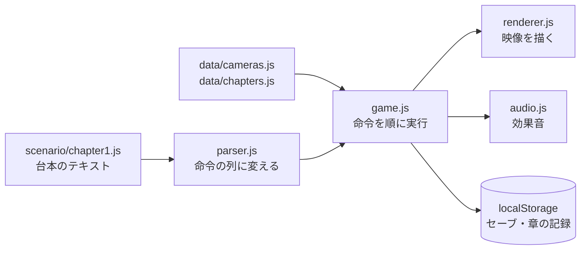

# アーキテクチャ

## リポジトリのフォルダ構成

```
├─ README.md
├─ .gitignore
├─ .github/workflows/pages.yml … master にプッシュしたら game/ を GitHub Pages に公開する
├─ spec/        … 仕様書
├─ design/      … 設計書
│  ├─ architecture/ … この文書
│  ├─ data/         … データの形式・台本の書き方
│  ├─ screens/      … 画面の構成
│  ├─ sequences/    … 処理の流れ
│  ├─ levels/       … 章の作り方の共通の決まり
│  └─ decisions/    … 設計判断の記録（ADR）
├─ game/        … ゲーム本体（このフォルダだけが公開される）
│  ├─ index.html      … 画面の骨組み。スクリプトを読み込む順番もここで決める
│  ├─ css/style.css   … 見た目
│  ├─ js/
│  │  ├─ parser.js    … 台本（テキスト）を命令の列に変える
│  │  ├─ renderer.js  … 監視映像の描画（背景・人物の影・ノイズ）
│  │  ├─ audio.js     … 効果音（Web Audio でその場で作る）
│  │  └─ game.js      … 台本の実行・画面・セーブ・章選択
│  ├─ data/
│  │  ├─ cameras.js   … カメラの一覧（背景の絵の指定も）
│  │  ├─ chapters.js  … 章の一覧
│  │  └─ characters.js … 立ち絵の一覧（人物と表情ごとの絵）
│  ├─ assets/         … 絵（chars/ 立ち絵・scenes/ 場面・bg/ カメラの背景）
│  └─ scenario/
│     └─ chapter1.js  … 第1章の台本
├─ assets_src/  … 素材の元ファイル（編集用）。公開されない
├─ testing/     … 確認の計画と結果
└─ tools/       … 開発用スクリプト（台本の自動テストなど）
```

- 絵は、元ファイルを `assets_src/images/` に置き（リポジトリには入れない）、`tools/optimize_images.ps1` で小さくしたものを `game/assets/` に入れる。

## 読み込みとキャッシュ

- `index.html` は、CSS と JS を `?v=<バージョン>` を付けて読み込む（例: `js/game.js?v=0.2.1`）。ブラウザやスマホが古いファイルを使い続けないようにするため。
- **`GAME_VERSION` を上げたら、`index.html` の `?v=` もすべて同じ番号に上げる。**

## 仕組みとシナリオの分け方

**シナリオは台本ファイルだけに書き、仕組み（js/）にはシナリオに依存することを書かない**ようにしています。シナリオを書き換えるときに触るのは、ふつう次の 3 つだけです。

| 書き換えたいこと | 触るファイル |
|---|---|
| 文章・選択肢・場面の流れ・干渉のパズル・映る人物 | `scenario/chapter<N>.js`（[書き方](../data/scenario_format.md)） |
| カメラを増やす・場所の名前を変える | `data/cameras.js` |
| 章を増やす・題名を変える | `data/chapters.js`（新しい章の台本ファイルは `index.html` の `<script>` にも足す） |

新しい背景・人物の種類・演出・効果音・命令が必要になったときだけ、`js/` に手を入れます。



## 台本の実行

- `parser.js` が台本を「命令の列」と「ラベルの位置」に変える。読み込んだ時点で、ないラベルへのジャンプを見つけて知らせる。
- `game.js` は命令を上から順に実行する（`OPS` が命令の一覧）。文章・選択肢・拭く操作・題名のカードなど、プレイヤーを待つ命令で止まり、操作されたら続きを実行する。
- `@choice` で止まっている間は「探索」の状態になる。カメラを切り替えたり、過去の時刻を動かしたりすると、見たことのない `@look`・`@event` の本文を読み、フラグを立てる。フラグが立つと選択肢を出し直す。
- 干渉できる機器（`@hotspot`）は、探索の状態のときだけ点滅し、押せる。
- ラベルに入るたびに状態を丸ごと写し取り、自動で保存する。バッドエンドからのやり直しも、この写しに戻して行う。

## 描画の仕組み

- 大画面の Canvas は 320x180。CSS で拡大し、`image-rendering: pixelated` で粗い映像に見せる。
- `requestAnimationFrame` で、約 30fps で描き直す。
  1. 映像を組み立てる（今の映像 / 過去の映像 / 監視室の外 / 映らない / 焼き付き）
  2. 背景と人物の影を描く（線と四角だけ。映像モードの色で描く）
  3. 干渉できる機器の点滅、カメラ名と時刻を描く
  4. 1 画素ずつ明るさをランダムに足す（ノイズ）、ときどき横方向に帯をずらす
- モニター壁の小さい映像（160x90）は、同じ描画の関数を縮小して使う。重くならないよう、1 回に 3 枚ずつ順番に描き直し、ノイズは簡単なものにする。
- 走査線・流れる帯・画面の端の暗さ・ちらつきは CSS で重ねる。

## 絵の扱い

- 絵はすべて「あれば使い、なければ線の絵で代わりに描く」。絵がそろっていなくても、ゲームはそのまま遊べる。
- 監視映像に使う絵は、Canvas の合成（`color`・`multiply`）で、明るさを残したまま緑・琥珀色に置き換える。そのあとに、ノイズと横ずれをかける。
- ファイルを直接開いたとき（`file://`）は、画像を描いた Canvas の画素を読めない（ブラウザの安全のための決まり）。そのときは画素ごとのノイズをやめて、横ずれと CSS の走査線だけにする。公開版（https）では、ノイズもかかる。
- 立ち絵は Canvas ではなく、HTML の画像として、テキストウィンドウの後ろに重ねて出す。

## 色の切り替え

- `body` に `mode-past` クラスを付けると、CSS 変数 `--tint` が緑からアンバーに変わる。監視室の外の場面（`outside` クラス）では、青みがかった灰色になる。ボタンやテキストウィンドウの色はすべて `--tint` を使う。
- Canvas の色は `renderer.js` の `TINTS` を使う。

## 自動テスト

`tools/playtest.js` は、画面の部品を「何もしない仮の部品」に置き換えて、ブラウザなしで台本を最後まで通して遊ぶ（Node.js で動く）。見ていないカメラを見る → 過去の出来事を見る → 選択肢 → 干渉、の順に自動で試し、行き詰まりや台本のエラーを見つける。
